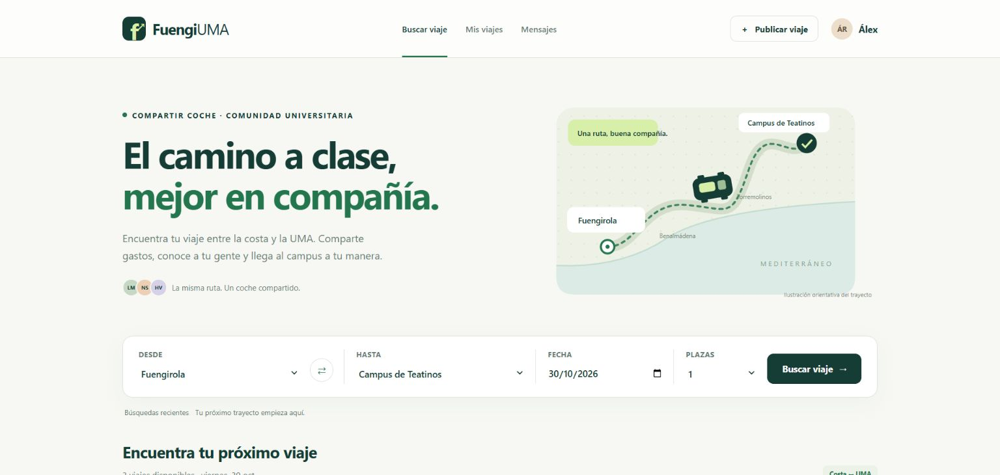
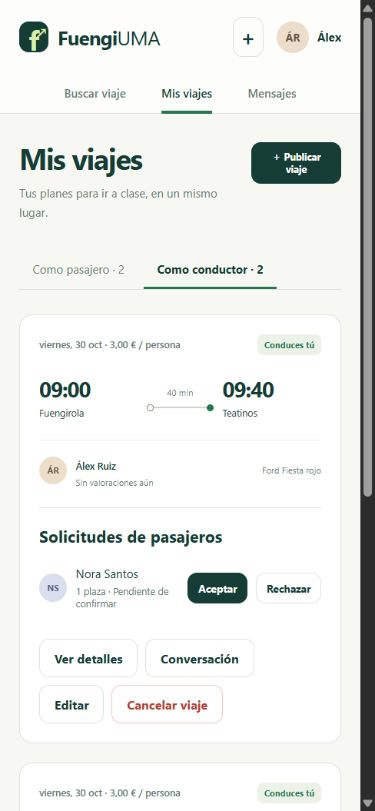

# FuengiUMA ↗

**Comparte el camino entre la costa y la Universidad de Málaga.**

[Archivos del prototipo](docs/) · [Pruebas en GitHub Actions](https://github.com/javidfdez/g1-ingenieriaSoftware/actions)

Aplicación de movilidad compartida para estudiantes: encuentra un trayecto, solicita plaza y coordina el punto de encuentro con sus participantes. El conductor publica sus viajes y confirma a los pasajeros.

Este repositorio reconstruye y amplía **FuengiUMA**, un proyecto colectivo de la asignatura de Ingeniería del Software de la UMA de 2022. La edición de portfolio de octubre de 2026 está desarrollada con asistencia de IA. Conserva la idea y los créditos originales; las mejoras actuales se documentan por separado en [Origen y evolución](documentation/ORIGEN.md). No es un servicio oficial de la universidad.



Desde la raíz del repositorio compartido, entra en `fuengiuma-2026/` para ejecutar los comandos de esta edición. La carpeta `fuengiuma/` conserva el proyecto original de 2022.

## Dos formas de probarlo

| | Aplicación Java | Prototipo para GitHub Pages |
|---|---|---|
| Inicio | Java 17 + Maven, o el JAR compilado | Abrir `docs/index.html` o servir `docs/` |
| Interfaz | HTML, CSS y JavaScript | La misma interfaz |
| Datos | H2 persistente en el servidor | Datos ficticios en el navegador |
| Sesión | Sesión HTTP, contraseñas BCrypt y CSRF | Simulación local de cuentas y permisos |
| Uso | Demostración técnica con API y persistencia | Recorrido interactivo del producto |

La demo estática funciona sin ejecutar Java. Sus cambios no se comparten entre navegadores. **GitHub Pages sirve el prototipo; la aplicación Java necesita su propio servidor.**

### Prototipo: sin instalación

Abre **`docs/index.html`** en un navegador actual. En Windows también puedes hacer doble clic en **`ABRIR-DEMO.cmd`**. Si el navegador restringe el almacenamiento de archivos locales, sirve `docs/` con cualquier servidor estático; por ejemplo, con Python instalado:

```sh
python -m http.server 8098 --bind 127.0.0.1 --directory docs
```

Abre `http://127.0.0.1:8098` y pulsa **Probar como Álex**. La demo estática se ha verificado en el navegador a través de HTTP.

### Aplicación completa

Requisitos: **Java 17 o superior y Maven 3.6.3 o superior**. La primera compilación descarga dependencias de Maven Central. Spring Boot: **3.5.16**.

```sh
mvn verify
java -jar target/fuengiuma-1.0.0.jar
```

Abre **`http://127.0.0.1:8097`**. Si ya tienes el JAR entregado, basta con `java -jar FuengiUMA-aplicacion.jar`; Maven solo es necesario para compilar. Durante el desarrollo puedes usar `mvn spring-boot:run`.

La base se crea en `data/` respecto al directorio desde el que arrancas Java y conserva los cambios entre reinicios. Los ejemplos se generan para mañana **en el primer arranque de una base vacía**. Para una demostración siempre nueva:

```sh
java -jar target/fuengiuma-1.0.0.jar "--spring.datasource.url=jdbc:h2:mem:demo;DB_CLOSE_DELAY=-1"
```

El servidor usa Europe/Madrid y escucha en `127.0.0.1` de forma predeterminada.

## Un recorrido de cinco minutos

1. Entra como **Álex** desde la demo o desde **Entrar → Explorar como Álex** en Java.
2. Busca **Fuengirola → Campus de Teatinos** para mañana. Cambia precio, horarios o plazas.
3. Abre el viaje de **Nora**, solicita plaza y comprueba que queda pendiente. Coordina la recogida en la conversación del viaje.
4. En **Mis viajes → Como conductor**, acepta la solicitud de Nora para el viaje de Álex de las 09:00. La disponibilidad se reduce al aceptarla.
5. Publica un trayecto y edítalo antes de recibir solicitudes activas.
6. En **Como pasajero**, valora el viaje finalizado con Lucía. La valoración modifica su media.

Los perfiles de muestra son ficticios. Para explorar otros roles puedes cerrar sesión y entrar con `lucia@uma.es`, `nora@uma.es`, `hugo@uma.es`, `irene@uma.es` o `alex@uma.es`. Todos usan la contraseña pública de ejemplo **`DemoUMA2026!`**. El registro admite `uma.es` y un subdominio como `alu.uma.es`; no verifica la titularidad del correo.

## Funcionalidades

- Búsqueda por localidad, campus, fecha, plazas, precio y horarios; últimas rutas buscadas.
- Registro, sesión, edición del perfil y valoraciones separadas como conductor y pasajero.
- Publicación, edición y cancelación de viajes entre la costa y un campus.
- Solicitudes pendientes, aceptación, rechazo, retirada de pasajeros y cancelación por el solicitante.
- Disponibilidad sobre plazas aceptadas; bloqueo de base de datos para impedir sobreocupación por aceptaciones simultáneas.
- Conversación por viaje para conductor y pasajeros con solicitud activa; actualización manual de mensajes.
- Valoraciones de 1 a 5 con comentario tras un viaje confirmado y finalizado, una por participante y reserva.
- Interfaz adaptable al móvil, formularios etiquetados, teclado y diálogos accesibles.

Los puntos de encuentro se concretan en las indicaciones o el chat. El dibujo de la ruta es orientativo. No hay geolocalización, pagos, notificaciones por correo ni mensajería en tiempo real.

## Tecnología y estructura

**Java 17 · Spring Boot · Spring MVC · Spring Data JPA · Hibernate · H2 · Bean Validation · BCrypt · JavaScript · HTML · CSS · JUnit · MockMvc**

```text
src/main/java/es/fuengiuma/
  ApiController.java      API REST y sesión
  RideService.java        Reglas de viajes, reservas, chat y valoraciones
  Domain.java             Entidades y estados de reserva
  Stores.java             Repositorios JPA
  Requests.java           Validación de entradas
  CsrfFilter.java         Protección de escrituras y cabeceras
  SeedData.java           Escenarios ficticios
src/main/resources/static/ Interfaz compartida y adaptador de demo
src/test/                 Pruebas de integración y concurrencia
tests/                    Pruebas del prototipo con Node
scripts/sync-demo.mjs      Generación de la copia para Pages
docs/                     Prototipo estático listo para publicar
documentation/            API, origen y validación
```

La interfaz consume la API en Java. En `docs/`, `demo.js` simula ese contrato en el navegador. Las entidades no se serializan directamente: las vistas omiten contraseñas y correos ajenos. El servidor comprueba identidad, permisos, estado y capacidad en cada operación. Consulta [el contrato de la API](documentation/API.md) y [la validación](documentation/VALIDACION.md).

## Pruebas y mantenimiento

```sh
mvn verify
node --test tests/demo.test.mjs
node scripts/sync-demo.mjs --check
```

Node 22 o superior sirve para las pruebas y la sincronización; no se necesita para usar la demo. Tras modificar `src/main/resources/static/`, actualiza la demo interior con `node scripts/sync-demo.mjs` y la copia de Pages de la raíz con `node scripts/sync-demo.mjs --shared-repo`.

GitHub Actions incluye compilación/pruebas Java y pruebas/sincronización del prototipo. Se ejecuta al subir cambios y su estado se consulta en la pestaña Actions.

## Subirlo a GitHub y activar la demo

Esta edición se incorpora en `fuengiuma-2026/` dentro del repositorio colectivo. El flujo de verificación se encuentra en `.github/workflows/fuengiuma-2026.yml` de la raíz y la copia de Pages en `docs/` de la raíz. La carpeta histórica `fuengiuma/` permanece intacta.

Para mostrar el prototipo online, el propietario o una persona con permisos de administración debe entrar en **Settings → Pages → Deploy from a branch**, seleccionar la rama principal y **`/docs`**, y guardar. `mariofdx21` tiene permisos de escritura en el repositorio compartido, pero no de administración; la demo queda preparada para esa activación. GitHub mostrará la dirección de la web cuando termine el despliegue. [Guía oficial de GitHub Pages](https://docs.github.com/en/pages/getting-started-with-github-pages/configuring-a-publishing-source-for-your-github-pages-site).

Descripción sugerida:

> Aplicación de coche compartido para estudiantes de la UMA. Java, Spring Boot y JPA, con reservas, chat, valoraciones y demo interactiva. Reconstrucción de un proyecto académico colectivo.

Temas: `java`, `spring-boot`, `jpa`, `carpooling`, `university-project`, `uma`, `javascript`.

## Configuración

| Variable | Valor predeterminado | Función |
|---|---|---|
| `PORT` | `8097` | Puerto HTTP |
| `FUENGIUMA_DB_URL` | `jdbc:h2:file:./data/fuengiuma;DB_CLOSE_ON_EXIT=FALSE` | Base de datos H2 |
| `FUENGIUMA_DB_PASSWORD` | Vacía | Contraseña de la base local |
| `FUENGIUMA_DEMO` | `true` | Carga inicial de ejemplos y acceso rápido a Álex |

Dockerfile opcional:

```sh
docker build -t fuengiuma .
docker run --rm -p 127.0.0.1:8097:8097 -v fuengiuma-data:/app/data fuengiuma
```

El contenedor escucha en `0.0.0.0` internamente; el ejemplo publica el puerto solo en el equipo local. Se verificó la entrega con Java y Maven, sin ejecutar Docker.

Esta edición es una demostración académica. Para un servicio real habría que añadir verificación de correo, recuperación de cuentas, limitación de intentos, HTTPS, gestión de datos personales y migraciones. Desactivar `FUENGIUMA_DEMO` retira el acceso rápido y la carga inicial; las cuentas de ejemplo ya existentes en una base persistente permanecen allí.

## Créditos

Proyecto original: [javidfdez/g1-ingenieriaSoftware](https://github.com/javidfdez/g1-ingenieriaSoftware). Equipo de su README:

- Carlos Rios Hita
- Javier Diaz Fernandez
- Alejandro Juan Hervás Vogt
- Mario Fernandez Castañeda
- Iván Lago Guerreira
- Manuel Gaviño Esparza
- Ismael Marin Ghalem

La reconstrucción de 2026 parte de los materiales aportados por Mario. No asigna contribuciones individuales sin evidencia. Este paquete no modifica ni relicencia el repositorio histórico. No se ha seleccionado una licencia adicional.

<details><summary>Más capturas</summary>



</details>
