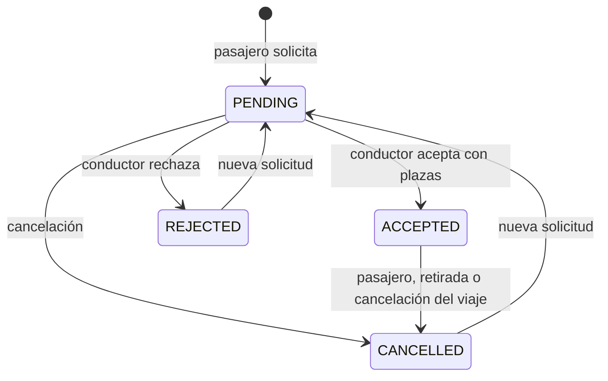

# Contrato de la API

API JSON en `/api`, mismo origen que la interfaz. Fechas `YYYY-MM-DD`, horas `HH:mm`, zona Europe/Madrid. Errores con `message` y estado HTTP. Las entidades JPA no se serializan directamente.

## Sesión

`GET /api/bootstrap` devuelve `today`, `locations`, `demoEnabled`, `me` y `csrfToken`. Conserva la cookie y envía `X-CSRF-Token` en POST, PATCH y DELETE. Sin token válido se devuelve 403. Al cerrar sesión solicita bootstrap de nuevo para obtener el token de la nueva sesión.

Cookie HttpOnly y SameSite=Strict; el identificador de sesión cambia al entrar. El perfil privado incluye el correo propio; los públicos omiten correos y contraseñas. Las contraseñas se almacenan con BCrypt.

| Método | Ruta relativa a `/api` | Entrada o resultado |
|---|---|---|
| GET | `/bootstrap` | Inicialización y sesión |
| POST | `/auth/register` | `{name,email,password}` → perfil privado |
| POST | `/auth/login` | `{email,password}` → perfil privado |
| POST | `/auth/demo` | Acceso a Álex, con demo activada |
| POST | `/auth/logout` | Invalida sesión |
| PATCH | `/me` | `{name,bio}` → perfil propio |
| GET | `/users/{id}` | Perfil público y valoraciones |
| GET | `/trips` | Viajes futuros disponibles |
| GET | `/trips/{id}` | Detalle según el usuario |
| POST | `/trips` | Crea un viaje del usuario conectado |
| PATCH | `/trips/{id}` | Edita uno propio sin solicitudes activas |
| DELETE | `/trips/{id}` | Cancela el viaje y solicitudes activas |
| POST | `/trips/{id}/bookings` | `{seats}` → solicitud pendiente |
| PATCH | `/bookings/{id}` | `{action}` → viaje actualizado |
| GET | `/me/trips` | `{driving,passenger}` |
| GET | `/conversations` | Viajes con conversación accesible |
| GET | `/trips/{id}/messages` | Mensajes del viaje |
| POST | `/trips/{id}/messages` | `{text}` → mensajes actualizados |
| POST | `/bookings/{id}/reviews` | `{rating,comment}` → perfil del destinatario |

### Filtros

Opcionales: `origin`, `destination`, `date`, `maxPrice`, `departAfter`, `arriveBefore`; `seats` vale 1 por defecto (rango 1–4). Localidades: `FUENGIROLA`, `MIJAS`, `BENALMADENA`, `TORREMOLINOS`, `CAMPUS_TEATINOS`, `CAMPUS_EL_EJIDO`.

```text
/api/trips?origin=FUENGIROLA&destination=CAMPUS_TEATINOS&date=2026-10-30&seats=1&maxPrice=4
```

### Publicar un viaje

```json
{
  "origin": "FUENGIROLA",
  "destination": "CAMPUS_TEATINOS",
  "date": "2026-10-30",
  "departure": "08:00",
  "arrival": "08:40",
  "price": 3.50,
  "capacity": 3,
  "car": "Seat Ibiza azul",
  "notes": "Recogida en la estación."
}
```

Adapta la fecha a un día futuro. El trayecto conecta un campus y una localidad. Llegada posterior a salida en el mismo día, duración inferior a cinco horas, precio 0–25 con hasta dos decimales y capacidad 1–4. El conductor se obtiene de la sesión.

### Estados y permisos



Acciones: `accept`, `reject` y `remove` para el conductor; `cancel` para el pasajero. La edición y gestión requieren viaje futuro. PENDING no consume plazas; ACCEPTED sí. Un bloqueo pesimista del viaje serializa la capacidad y la reserva se refresca después del bloqueo. Solo el conductor ve la lista de solicitudes; cada pasajero ve la suya.

Chat colectivo por viaje: conductor y pasajeros con solicitud PENDING o ACCEPTED. Cerrar una solicitud retira el acceso del pasajero. Un viaje cancelado conserva el historial del conductor, sin mensajes nuevos.

La valoración exige reserva ACCEPTED, llegada pasada, viaje no cancelado y participación del autor. El destinatario se deduce de la reserva. Una restricción única impide duplicar la valoración de un autor para la misma reserva.

## Prototipo

`FuengiDemo.create(storage, cryptoProvider).api(path, method, body)` reproduce el contrato para la interfaz. Los datos y permisos se simulan en el cliente: no representa una frontera de seguridad. Las cuentas nuevas usan PBKDF2 con sal aleatoria y no guardan contraseñas en claro. Las cuentas de ejemplo tienen una contraseña pública.
